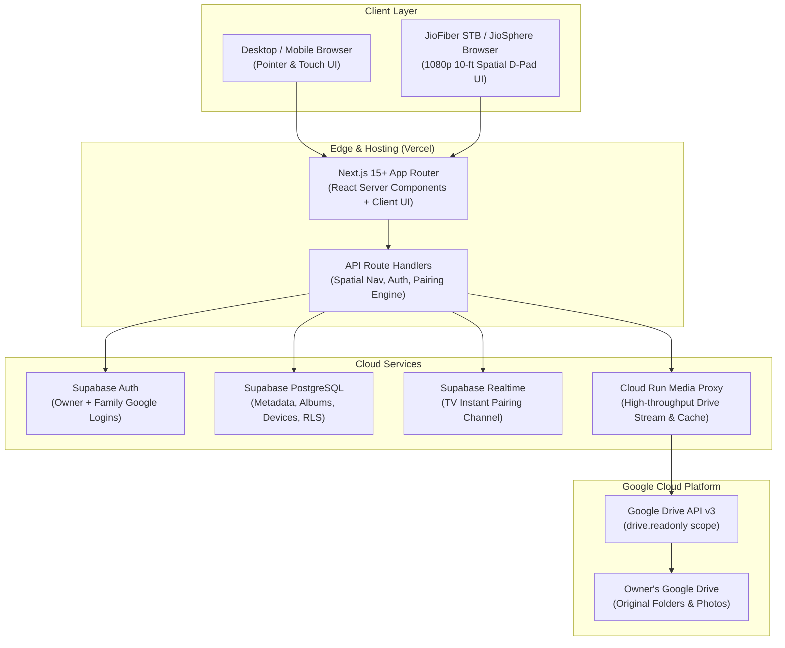
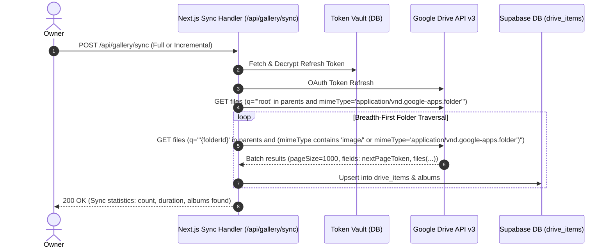
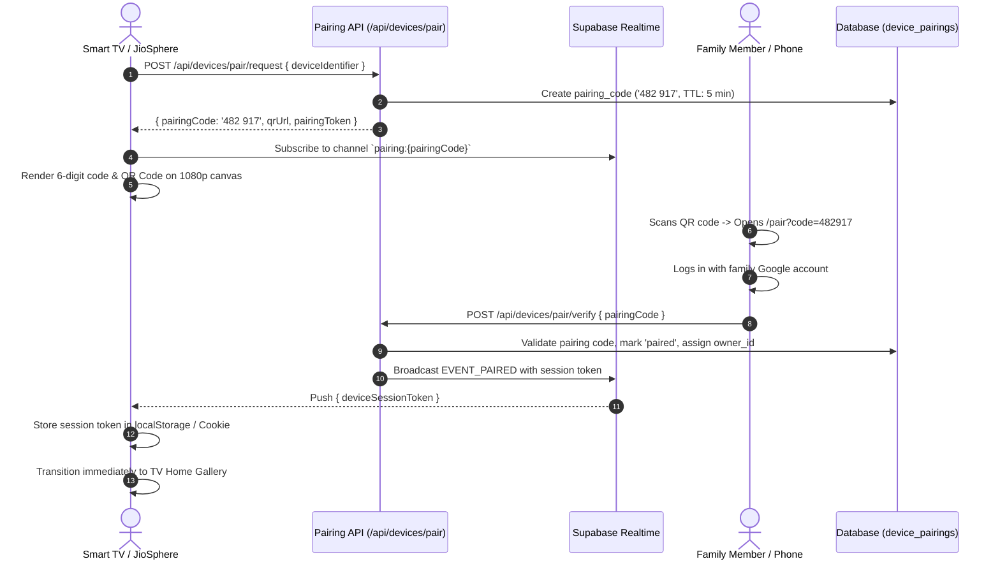
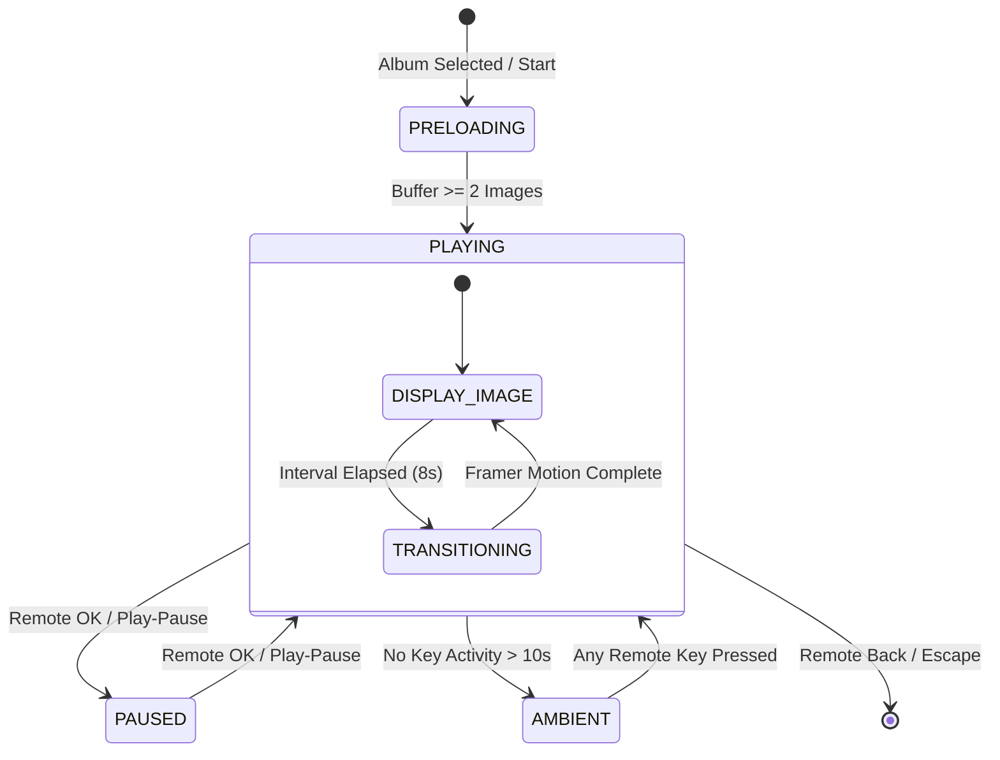

# DriveFrame TV: Master Development Specification

**Document Version:** 1.0.0  
**Target Platform:** Next.js 15+ (App Router), Supabase (Auth & PostgreSQL), Google Drive API v3, JioSphere TV Browser (1080p D-Pad Navigation)  
**Security Level:** Encrypted Token Vault, Row Level Security (RLS), Short-lived TV Device Pairing  

---

## 1. System Architecture & Component Topology

DriveFrame TV transforms a user's Google Drive into a private, family-accessible television photo gallery and cinematic ambient frame. The system uses a centralized backend architecture so Google Drive is connected once by the administrator (Owner), while family members and TV devices authenticate via lightweight accounts and device pairing without direct Google Drive credentials.

### 1.1 Architecture Diagram



### 1.2 Data Flow & Role Boundaries

| Role | Auth Mechanism | Capabilities | Restrictions |
| :--- | :--- | :--- | :--- |
| **Owner** | Google OAuth (`drive.readonly` + email) | Connect/Disconnect Drive, trigger sync, invite/revoke family, pair TVs, configure global album visibility. | Cannot expose raw refresh token to browser. |
| **Family Member** | Google OAuth (`email` only) or Supabase Magic Link | Browse authorized albums, create slideshow sessions, toggle personal favorites. | Read-only access to Drive metadata; no folder re-scans or member management. |
| **TV Device** | 6-Digit Device Pairing Code (HMAC-backed token) | View authorized gallery, execute 1080p slideshow, report session heartbeat. | Cannot access account management or invite members. |

---

## 2. Database Schema & Supabase PostgreSQL DDL

All timestamps are stored in UTC with timezone. Passwords and Google Drive refresh tokens are encrypted using AES-256-GCM prior to database persistence.

### 2.1 Complete SQL Migration Script

```sql
-- Enable necessary extensions
create extension if not exists "uuid-ossp";
create extension if not exists "pgcrypto";

-- Enum types
create type user_role as enum ('owner', 'family');
create type member_status as enum ('pending', 'approved', 'revoked');
create type device_type as enum ('tv', 'browser', 'mobile');
create type pairing_status as enum ('pending', 'paired', 'expired');
create type slideshow_fit as enum ('cover', 'contain', 'smart_fill');
create type transition_style as enum ('fade', 'crossfade', 'slide', 'ken_burns');

-- 1. Profiles Table
create table public.profiles (
    id uuid references auth.users on delete cascade primary key,
    email text not null unique,
    display_name text,
    avatar_url text,
    created_at timestamp with time zone default timezone('utc'::text, now()) not null,
    updated_at timestamp with time zone default timezone('utc'::text, now()) not null
);

-- 2. Family Members Table
create table public.family_members (
    id uuid default uuid_generate_v4() primary key,
    owner_id uuid references public.profiles(id) on delete cascade not null,
    user_id uuid references public.profiles(id) on delete cascade,
    invited_email text not null,
    role user_role default 'family'::user_role not null,
    status member_status default 'pending'::member_status not null,
    created_at timestamp with time zone default timezone('utc'::text, now()) not null,
    updated_at timestamp with time zone default timezone('utc'::text, now()) not null,
    unique(owner_id, invited_email)
);

-- 3. Google Drive Connections (Token Vault)
create table public.drive_connections (
    id uuid default uuid_generate_v4() primary key,
    owner_id uuid references public.profiles(id) on delete cascade not null unique,
    encrypted_access_token text not null,
    encrypted_refresh_token text not null,
    token_iv text not null,
    token_tag text not null,
    token_expiry timestamp with time zone not null,
    drive_user_email text not null,
    root_folder_id text default 'root' not null,
    sync_status text default 'idle' not null, -- 'idle', 'syncing', 'error'
    last_synced_at timestamp with time zone,
    sync_error_message text,
    created_at timestamp with time zone default timezone('utc'::text, now()) not null,
    updated_at timestamp with time zone default timezone('utc'::text, now()) not null
);

-- 4. Drive Items (Normalized File & Folder Hierarchy)
create table public.drive_items (
    id uuid default uuid_generate_v4() primary key,
    file_id text not null,
    owner_id uuid references public.profiles(id) on delete cascade not null,
    name text not null,
    mime_type text not null,
    parent_id text,
    size bigint default 0,
    drive_created_time timestamp with time zone,
    drive_modified_time timestamp with time zone,
    thumbnail_link text,
    width integer,
    height integer,
    is_folder boolean default false not null,
    trashed boolean default false not null,
    metadata_json jsonb default '{}'::jsonb,
    created_at timestamp with time zone default timezone('utc'::text, now()) not null,
    updated_at timestamp with time zone default timezone('utc'::text, now()) not null,
    unique(owner_id, file_id)
);

-- 5. Curated Albums
create table public.albums (
    id uuid default uuid_generate_v4() primary key,
    owner_id uuid references public.profiles(id) on delete cascade not null,
    folder_id text not null,
    title text not null,
    description text,
    cover_file_id text,
    photo_count integer default 0 not null,
    is_hidden boolean default false not null,
    custom_order integer default 0 not null,
    created_at timestamp with time zone default timezone('utc'::text, now()) not null,
    updated_at timestamp with time zone default timezone('utc'::text, now()) not null,
    unique(owner_id, folder_id)
);

-- 6. Favorites Table
create table public.favorites (
    id uuid default uuid_generate_v4() primary key,
    user_id uuid references public.profiles(id) on delete cascade not null,
    file_id text not null,
    created_at timestamp with time zone default timezone('utc'::text, now()) not null,
    unique(user_id, file_id)
);

-- 7. TV & Client Devices
create table public.devices (
    id uuid default uuid_generate_v4() primary key,
    owner_id uuid references public.profiles(id) on delete cascade not null,
    paired_by_user_id uuid references public.profiles(id) on delete set null,
    device_identifier text not null unique,
    device_name text not null,
    device_type device_type default 'tv'::device_type not null,
    ip_address text,
    user_agent text,
    is_authorized boolean default true not null,
    device_token_hash text not null,
    last_active_at timestamp with time zone default timezone('utc'::text, now()) not null,
    created_at timestamp with time zone default timezone('utc'::text, now()) not null
);

-- 8. Device Pairings (Temporary 6-Digit Handshake)
create table public.device_pairings (
    id uuid default uuid_generate_v4() primary key,
    pairing_code text not null unique,
    device_identifier text not null,
    device_name text default 'Smart TV / JioSphere' not null,
    status pairing_status default 'pending'::pairing_status not null,
    owner_id uuid references public.profiles(id) on delete cascade,
    paired_user_id uuid references public.profiles(id) on delete set null,
    device_session_token text,
    expires_at timestamp with time zone not null,
    created_at timestamp with time zone default timezone('utc'::text, now()) not null
);

-- 9. Slideshow Sessions & Preferences
create table public.user_settings (
    user_id uuid references public.profiles(id) on delete cascade primary key,
    slideshow_duration integer default 8 not null,
    slideshow_transition transition_style default 'crossfade'::transition_style not null,
    slideshow_shuffle boolean default false not null,
    slideshow_fit slideshow_fit default 'cover'::slideshow_fit not null,
    ambient_clock_enabled boolean default true not null,
    ambient_metadata_enabled boolean default true not null,
    ambient_weather_enabled boolean default false not null,
    ken_burns_intensity real default 1.15 not null,
    created_at timestamp with time zone default timezone('utc'::text, now()) not null,
    updated_at timestamp with time zone default timezone('utc'::text, now()) not null
);

-- Indexes for high-throughput queries
create index idx_drive_items_parent on public.drive_items(owner_id, parent_id) where not trashed;
create index idx_drive_items_folder on public.drive_items(owner_id, is_folder) where not trashed;
create index idx_drive_items_file on public.drive_items(file_id);
create index idx_device_pairings_code on public.device_pairings(pairing_code) where status = 'pending';
create index idx_family_members_user on public.family_members(user_id, status);
create index idx_favorites_user on public.favorites(user_id);
```

### 2.2 Row Level Security (RLS) Policies

```sql
-- Enable RLS across all tables
alter table public.profiles enable row level security;
alter table public.family_members enable row level security;
alter table public.drive_connections enable row level security;
alter table public.drive_items enable row level security;
alter table public.albums enable row level security;
alter table public.favorites enable row level security;
alter table public.devices enable row level security;
alter table public.device_pairings enable row level security;
alter table public.user_settings enable row level security;

-- Helper function: Check if caller is approved family member or owner
create or replace function public.is_authorized_viewer(target_owner_id uuid)
returns boolean security definer as $$
begin
    return (
        auth.uid() = target_owner_id
        or exists (
            select 1 from public.family_members fm
            where fm.owner_id = target_owner_id
              and fm.user_id = auth.uid()
              and fm.status = 'approved'
        )
    );
end;
$$ language plpgsql;

-- 1. Profiles: Users can view authorized peers, update own profile
create policy "Users read own profile" on public.profiles
    for select using (auth.uid() = id);

create policy "Users update own profile" on public.profiles
    for update using (auth.uid() = id);

-- 2. Drive Items: Owner and approved family can read non-trashed photos
create policy "Authorized users read drive items" on public.drive_items
    for select using (public.is_authorized_viewer(owner_id) and not trashed);

create policy "Owner manages drive items" on public.drive_items
    for all using (auth.uid() = owner_id);

-- 3. Albums: Read by authorized viewers, managed by owner
create policy "Authorized users read albums" on public.albums
    for select using (public.is_authorized_viewer(owner_id) and not is_hidden);

create policy "Owner manages albums" on public.albums
    for all using (auth.uid() = owner_id);

-- 4. Favorites: Managed privately per user
create policy "Users manage own favorites" on public.favorites
    for all using (auth.uid() = user_id);

-- 5. Drive Connections: Restrict strictly to Owner (NEVER exposed to family)
create policy "Only owner accesses drive connection" on public.drive_connections
    for all using (auth.uid() = owner_id);

-- 6. Device Pairings: Public read for TV polling by pairing_code
create policy "Public pair check" on public.device_pairings
    for select using (true);

create policy "Authenticated users update pairings" on public.device_pairings
    for update using (auth.role() = 'authenticated');
```

---

## 3. Google Drive Integration & Sync Engine

### 3.1 OAuth 2.0 Credential Vault
- Scope: `https://www.googleapis.com/auth/drive.readonly`
- Access tokens expire every 3600 seconds; refresh tokens must be encrypted before database storage.
- **Encryption Scheme:** AES-256-GCM.
  - Secret key: 32-byte key derived from `DRIVE_TOKEN_ENCRYPTION_KEY`.
  - IV: 12-byte random IV per record.
  - Tag: 16-byte authentication tag ensuring ciphertext integrity.

```typescript
// services/drive-api/security/token-crypto.ts
import crypto from 'node:crypto';

const ALGORITHM = 'aes-256-gcm';
const KEY = Buffer.from(process.env.DRIVE_TOKEN_ENCRYPTION_KEY!, 'hex');

export interface EncryptedPayload {
  cipherText: string;
  iv: string;
  tag: string;
}

export function encryptToken(token: string): EncryptedPayload {
  const iv = crypto.randomBytes(12);
  const cipher = crypto.createCipheriv(ALGORITHM, KEY, iv);
  let encrypted = cipher.update(token, 'utf8', 'hex');
  encrypted += cipher.final('hex');
  const tag = cipher.getAuthTag().toString('hex');
  return { cipherText: encrypted, iv: iv.toString('hex'), tag };
}

export function decryptToken(payload: EncryptedPayload): string {
  const decipher = crypto.createDecipheriv(ALGORITHM, KEY, Buffer.from(payload.iv, 'hex'));
  decipher.setAuthTag(Buffer.from(payload.tag, 'hex'));
  let decrypted = decipher.update(payload.cipherText, 'hex', 'utf8');
  decrypted += decipher.final('utf8');
  return decrypted;
}
```

### 3.2 Recursive Drive Scanner & Delta Sync
The sync engine builds the hierarchy without loading all binary files into server memory:



**Sync Query Specifications:**
- Supported Image MIME types: `image/jpeg`, `image/png`, `image/webp`, `image/heic`, `image/avif`.
- Excluded folders: Folders starting with `.` or containing `.nomedia`.
- Incremental Sync: Utilizes Drive `changes.list` with `startPageToken` stored in `drive_connections.sync_status`.

---

## 4. Media Proxy & Image Streaming Architecture

To prevent exposing raw Google credentials and to bypass cross-origin restrictions on TV browsers, all high-resolution photos and thumbnails stream through a dedicated media proxy route.

### 4.1 Endpoint: `/api/media/[fileId]`
- **Query Params:**
  - `variant`: `thumb` (512px max edge for album browsing) | `preview` (1920px for TV slideshow) | `original` (full resolution).
- **HTTP Caching Headers:**
  - `Cache-Control: private, max-age=604800, stale-while-revalidate=86400`
  - `ETag: W/"{fileId}-{modifiedTime}"`
- **Range Request Support:** Accepts `Range: bytes=0-1048576` for chunked image downloads, vital for memory-constrained Smart TV browsers.

```typescript
// app/api/media/[fileId]/route.ts
import { NextRequest, NextResponse } from 'next/server';
import { getDriveClientForUser } from '@/services/drive-api/auth/client';
import { verifyViewerAccess } from '@/services/drive-api/security/auth-guard';

export async function GET(
  req: NextRequest,
  { params }: { params: Promise<{ fileId: string }> }
) {
  const { fileId } = await params;
  const authContext = await verifyViewerAccess(req, fileId);
  if (!authContext) {
    return NextResponse.json({ error: 'Unauthorized' }, { status: 401 });
  }

  const drive = await getDriveClientForUser(authContext.ownerId);
  const variant = req.nextUrl.searchParams.get('variant') || 'preview';

  // For thumbnails, redirect to Google cached thumbnail with valid size spec
  if (variant === 'thumb') {
    const fileMeta = await drive.files.get({
      fileId,
      fields: 'thumbnailLink, mimeType',
    });
    if (fileMeta.data.thumbnailLink) {
      // Modify Google s220 default to s600
      const highResThumb = fileMeta.data.thumbnailLink.replace(/=s\d+$/, '=s600');
      return NextResponse.redirect(highResThumb);
    }
  }

  // High-resolution stream for 1080p TV Slideshow
  const driveStream = await drive.files.get(
    { fileId, alt: 'media' },
    { responseType: 'stream' }
  );

  const headers = new Headers();
  headers.set('Content-Type', driveStream.headers['content-type'] || 'image/jpeg');
  headers.set('Cache-Control', 'private, max-age=604800, stale-while-revalidate=86400');

  // Return standard ReadableStream
  return new NextResponse(driveStream.data as any, { headers });
}
```

---

## 5. TV Zero-Password Pairing Subsystem

### 5.1 Pairing Flow Diagram



### 5.2 Pairing Security Rules
1. Codes are formatted as `XXX XXX` (6 alphanumeric characters omitting ambiguous letters `0, O, 1, I, L`).
2. Maximum 5 attempts per IP per minute (sliding window rate limiter in Redis or Upstash).
3. 300-second TTL (5 minutes). Once paired or expired, records are invalidated immediately.
4. Paired TV tokens are cryptographically signed HMAC tokens containing `device_id` and `owner_id`.

---

## 6. Spatial Navigation Engine (10-Foot D-Pad Focus Manager)

TV browsers like **JioSphere on JioFiber STB** do not have a mouse or touch screen. All interactions rely on remote controls broadcasting standard keyboard events.

### 6.1 Key Code Mapping Matrix

| Remote Control Key | Event `key` | Event `keyCode` | Spatial Nav Action |
| :--- | :--- | :--- | :--- |
| **D-Pad Up** | `'ArrowUp'` | `38` | Move focus to nearest element above |
| **D-Pad Down** | `'ArrowDown'` | `40` | Move focus to nearest element below |
| **D-Pad Left** | `'ArrowLeft'` | `37` | Move focus to element to the left |
| **D-Pad Right** | `'ArrowRight'` | `39` | Move focus to element to the right |
| **OK / Center** | `'Enter'` | `13` | Trigger click / Select / Toggle Play |
| **Back / Return** | `'Escape'` / `'Backspace'` | `27` / `8` / `10009` | Go back / Exit slideshow to album |
| **Play / Pause** | `'MediaPlayPause'` | `179` / `415` | Toggle slideshow play/pause |
| **Menu / Info** | `'Menu'` / `'Info'` | `462` / `457` | Toggle Ambient clock & photo metadata |

### 6.2 Spatial Navigation Algorithm & Architecture

```typescript
// packages/spatial-navigation/useSpatialNav.ts
'use client';

import { useEffect, useRef, useState, useCallback } from 'react';

export interface FocusableNode {
  id: string;
  ref: HTMLElement;
  row: number;
  col: number;
  onSelect?: () => void;
  onBack?: () => void;
}

export function useSpatialNav(initialFocusId?: string) {
  const registry = useRef<Map<string, FocusableNode>>(new Map());
  const [currentFocusId, setCurrentFocusId] = useState<string | null>(initialFocusId || null);

  const registerNode = useCallback((node: FocusableNode) => {
    registry.current.set(node.id, node);
    if (!currentFocusId && registry.current.size === 1) {
      setCurrentFocusId(node.id);
    }
    return () => {
      registry.current.delete(node.id);
    };
  }, [currentFocusId]);

  const handleKeyDown = useCallback((e: KeyboardEvent) => {
    const active = currentFocusId ? registry.current.get(currentFocusId) : null;
    if (!active) return;

    let targetNode: FocusableNode | null = null;

    switch (e.key) {
      case 'ArrowRight': {
        const rowCandidates = Array.from(registry.current.values())
          .filter(n => n.row === active.row && n.col > active.col)
          .sort((a, b) => a.col - b.col);
        targetNode = rowCandidates[0] || null;
        break;
      }
      case 'ArrowLeft': {
        const rowCandidates = Array.from(registry.current.values())
          .filter(n => n.row === active.row && n.col < active.col)
          .sort((a, b) => b.col - a.col);
        targetNode = rowCandidates[0] || null;
        break;
      }
      case 'ArrowDown': {
        const colCandidates = Array.from(registry.current.values())
          .filter(n => n.row > active.row)
          .sort((a, b) => {
            const rowDiff = a.row - b.row;
            if (rowDiff !== 0) return rowDiff;
            return Math.abs(a.col - active.col) - Math.abs(b.col - active.col);
          });
        targetNode = colCandidates[0] || null;
        break;
      }
      case 'ArrowUp': {
        const colCandidates = Array.from(registry.current.values())
          .filter(n => n.row < active.row)
          .sort((a, b) => {
            const rowDiff = b.row - a.row;
            if (rowDiff !== 0) return rowDiff;
            return Math.abs(a.col - active.col) - Math.abs(b.col - active.col);
          });
        targetNode = colCandidates[0] || null;
        break;
      }
      case 'Enter':
        e.preventDefault();
        active.onSelect?.();
        return;
      case 'Backspace':
      case 'Escape':
        e.preventDefault();
        active.onBack?.();
        return;
      default:
        return;
    }

    if (targetNode) {
      e.preventDefault();
      setCurrentFocusId(targetNode.id);
      targetNode.ref.focus();
      targetNode.ref.scrollIntoView({ behavior: 'smooth', block: 'center', inline: 'center' });
    }
  }, [currentFocusId]);

  useEffect(() => {
    window.addEventListener('keydown', handleKeyDown);
    return () => window.removeEventListener('keydown', handleKeyDown);
  }, [handleKeyDown]);

  return { currentFocusId, setCurrentFocusId, registerNode };
}
```

### 6.3 10-Foot Design Tokens & Safe Areas
- **Overscan Guard:** All TV pages enforce a 5% margin (`p-[5vw]` / `p-[5vh]`) so content is never clipped by TV edge overscan.
- **Minimum Focusable Card Size:** 280px × 180px for album cards.
- **Focus Rings:**
  - Standard state: `border border-transparent scale-100 opacity-90`
  - Focused state: `border-4 border-amber-400 shadow-[0_0_35px_rgba(251,191,36,0.6)] scale-105 z-20 transition-all duration-200`
- **Typography Scale for 10-Foot Viewing (1920×1080 canvas):**
  - Hero Header: `text-5xl font-bold tracking-tight` (48px)
  - Section Headers: `text-3xl font-semibold` (30px)
  - Card Titles: `text-2xl font-medium` (24px)
  - Metadata / Badges: `text-lg font-normal text-zinc-400` (18px)
  - Smallest allowed text: `text-base` (16px) - never below 16px.

---

## 7. Cinematic Slideshow Engine

### 7.1 Slideshow State Machine



### 7.2 Double-Buffered Preloader Pipeline
Smart TVs running web browsers have strict RAM budgets (often <500MB available for JavaScript). Loading 50 full-resolution images crashes the tab.
The DriveFrame preloader maintains an **LRU Window of exactly 3 images**:
- `Index - 1`: Previous image (kept for fast reverse navigation)
- `Index`: Currently displayed full-resolution image
- `Index + 1`: Next image (preloaded silently in memory via `new Image()`)
- `Index + 2`: Pre-fetching HTTP stream header

```typescript
// packages/slideshow-engine/usePhotoPreloader.ts
'use client';

import { useEffect, useRef } from 'react';

export function usePhotoPreloader(photos: Array<{ id: string; url: string }>, currentIndex: number) {
  const cacheRef = useRef<Map<number, HTMLImageElement>>(new Map());

  useEffect(() => {
    const indicesToLoad = [
      currentIndex,
      (currentIndex + 1) % photos.length,
      (currentIndex + 2) % photos.length,
    ];

    indicesToLoad.forEach(idx => {
      if (!cacheRef.current.has(idx) && photos[idx]) {
        const img = new Image();
        img.src = photos[idx].url;
        cacheRef.current.set(idx, img);
      }
    });

    // Evict items outside active window
    for (const [key] of cacheRef.current.entries()) {
      const distance = Math.abs(key - currentIndex);
      if (distance > 2 && distance < photos.length - 2) {
        cacheRef.current.delete(key);
      }
    }
  }, [photos, currentIndex]);
}
```

### 7.3 Framer Motion Ken Burns & Cinematic Transitions

```tsx
// components/slideshow/SlideshowView.tsx
'use client';

import { motion, AnimatePresence } from 'framer-motion';

interface SlideshowViewProps {
  currentPhoto: { id: string; url: string; title: string; date?: string };
  transitionType: 'crossfade' | 'ken_burns' | 'slide';
  isAmbient: boolean;
}

export function SlideshowView({ currentPhoto, transitionType, isAmbient }: SlideshowViewProps) {
  const variants = {
    crossfade: {
      initial: { opacity: 0 },
      animate: { opacity: 1, transition: { duration: 1.6, ease: 'easeInOut' } },
      exit: { opacity: 0, transition: { duration: 1.2 } },
    },
    ken_burns: {
      initial: { opacity: 0, scale: 1.0 },
      animate: {
        opacity: 1,
        scale: 1.12,
        transition: {
          opacity: { duration: 1.4 },
          scale: { duration: 10, ease: 'linear' },
        },
      },
      exit: { opacity: 0, transition: { duration: 1.2 } },
    },
  };

  return (
    <div className="relative w-screen h-screen overflow-hidden bg-black select-none">
      {/* Blurred Ambient Backdrop for non-16:9 photos */}
      <div
        className="absolute inset-0 bg-cover bg-center filter blur-3xl opacity-30 transform scale-110"
        style={{ backgroundImage: `url(${currentPhoto.url})` }}
      />

      <AnimatePresence mode="wait">
        <motion.div
          key={currentPhoto.id}
          variants={variants[transitionType === 'ken_burns' ? 'ken_burns' : 'crossfade']}
          initial="initial"
          animate="animate"
          exit="exit"
          className="absolute inset-0 flex items-center justify-center p-0"
        >
          
        </motion.div>
      </AnimatePresence>

      {/* Ambient Mode Overlay: Clock & Photo Metadata */}
      {isAmbient && (
        <div className="absolute bottom-10 left-12 z-30 pointer-events-none transition-opacity duration-700">
          <p className="text-white/90 text-2xl font-light tracking-wide drop-shadow-md">
            {currentPhoto.title}
          </p>
          {currentPhoto.date && (
            <p className="text-white/60 text-base font-normal drop-shadow-sm mt-1">
              {currentPhoto.date}
            </p>
          )}
        </div>
      )}
    </div>
  );
}
```

---

## 8. Complete API Contracts & TypeScript Interfaces

### 8.1 TypeScript Types (`packages/shared-types/index.ts`)

```typescript
export type UserRole = 'owner' | 'family';
export type MemberStatus = 'pending' | 'approved' | 'revoked';
export type DeviceType = 'tv' | 'browser' | 'mobile';

export interface Profile {
  id: string;
  email: string;
  displayName?: string;
  avatarUrl?: string;
  createdAt: string;
}

export interface DriveItem {
  id: string;
  fileId: string;
  name: string;
  mimeType: string;
  parentId: string | null;
  size: number;
  thumbnailLink?: string;
  width?: number;
  height?: number;
  isFolder: boolean;
  driveCreatedTime?: string;
}

export interface Album {
  id: string;
  folderId: string;
  title: string;
  description?: string;
  coverFileId?: string;
  photoCount: number;
  isHidden: boolean;
  customOrder: number;
}

export interface DevicePairingRequest {
  deviceIdentifier: string;
  deviceName?: string;
}

export interface DevicePairingResponse {
  pairingCode: string;
  qrPayload: string;
  expiresInSeconds: number;
  deviceSessionToken: string;
}

export interface SlideshowConfig {
  durationSeconds: number;
  transition: 'crossfade' | 'ken_burns' | 'slide';
  shuffle: boolean;
  fitMode: 'cover' | 'contain';
  ambientOverlay: boolean;
}
```

### 8.2 API Endpoints Matrix

| Endpoint | Method | Auth Required | Request Body / Query | Response Payload | Description |
| :--- | :--- | :--- | :--- | :--- | :--- |
| `/api/auth/drive/connect` | `GET` | Owner JWT | None | `{ url: string }` | Initiates Google OAuth consent flow with `drive.readonly`. |
| `/api/auth/drive/callback`| `GET` | None | `?code=...&state=...` | Redirect to `/dashboard?connected=true` | Exchanges code for refresh token, encrypts in DB. |
| `/api/gallery/folders` | `GET` | Family / TV JWT | None | `{ folders: Album[] }` | Returns recursive folder list mapped as albums. |
| `/api/gallery/albums/[id]` | `GET` | Family / TV JWT | `?page=1&limit=50` | `{ album: Album, photos: DriveItem[] }` | Retrieves photos inside a specific album. |
| `/api/media/[fileId]` | `GET` | Family / TV JWT | `?variant=thumb\|preview` | Image Binary Stream | Streams optimized JPEG/WebP with client caching headers. |
| `/api/gallery/sync` | `POST` | Owner JWT | `{ mode: 'incremental' \| 'full' }` | `{ scanned: number, added: number }` | Triggers background Google Drive crawler. |
| `/api/devices/pair/request`| `POST` | Public | `{ deviceIdentifier, deviceName }` | `DevicePairingResponse` | TV requests new 6-digit handshake code. |
| `/api/devices/pair/verify` | `POST` | Family Member JWT| `{ pairingCode: string }` | `{ success: boolean, deviceName: string }` | Mobile user approves TV pairing code. |
| `/api/favorites` | `POST` | Family Member JWT| `{ fileId: string }` | `{ favorited: boolean }` | Toggles photo in user's private favorites list. |

---

## 9. JioFiber TV STB & JioSphere Compatibility Matrix

### 9.1 Hardware & Browser Profile (JioFiber Set-Top Box)
- **Browser:** JioSphere (Chromium 88+ base for Android TV / KaiOS variants).
- **Resolution:** 1920 × 1080 (CSS 1080p, `devicePixelRatio: 1` or `1.5`).
- **RAM Constraint:** 1 GB - 2 GB total system memory; Browser heap limit ~300 MB.
- **Hardware Acceleration:** WebGL 1.0 supported, CSS 3D transforms (`transform: translate3d`) hardware accelerated.

### 9.2 Optimization Directives for JioSphere
1. **Never use heavy JavaScript canvas filters** like live backdrop blur filters on 4K elements. Use pre-rendered CSS gradients or lightweight blurred 100px backdrop tiles.
2. **Explicit Image Downsampling:** Never pipe 24-megapixel camera originals directly into the browser DOM. The media proxy `/api/media/[id]?variant=preview` must downscale images to max 1920×1080 before delivering to JioSphere.
3. **Audio / Video Codecs:** JPEG and WebP are natively supported. Avoid raw HEIC without server-side transcoding.
4. **Prevent Focus Traps:** Disable standard browser tab navigation in TV mode (`tabIndex={-1}`) and route all keys strictly through the Spatial Navigation Manager.

---

## 10. Implementation Roadmap & Execution Checklist

### Phase 1 — Project Scaffold & Design Tokens (Days 1–3)
- [ ] Initialize Next.js 15+ App Router project with TypeScript and Tailwind CSS v4 / v3.4.
- [ ] Install dependencies: `lucide-react`, `framer-motion`, `@supabase/supabase-js`, `googleapis`.
- [ ] Configure 1080p TV safe areas, color tokens (`zinc-950` deep black, `amber-400` focus ring).
- [ ] Implement responsive viewport switches (`/` for Desktop/Mobile, `/tv` for 10-foot STB interface).

### Phase 2 — Supabase & AES-GCM Token Vault (Days 4–6)
- [ ] Execute Database Migration script in Supabase PostgreSQL console.
- [ ] Configure Row Level Security (RLS) policies and test with Owner vs Member roles.
- [ ] Build AES-256-GCM encryption/decryption utilities for Google refresh tokens.
- [ ] Create Supabase server client and auth middleware in Next.js.

### Phase 3 — Google Drive OAuth & Recursive Crawler (Days 7–10)
- [ ] Configure Google Cloud Console project with OAuth credentials and `drive.readonly` scope.
- [ ] Implement `/api/auth/drive/connect` and `/api/auth/drive/callback` routes.
- [ ] Build Breadth-First Search (BFS) Google Drive recursive folder crawler.
- [ ] Implement thumbnail URL generator and file metadata ingest into `drive_items`.

### Phase 4 — High-Throughput Media Streaming Proxy (Days 11–13)
- [ ] Implement `/api/media/[fileId]` route with chunked streaming and cache headers.
- [ ] Build Sharp/Canvas downsampling service or Google thumbnail redirect for 512px previews.
- [ ] Validate HTTP 206 partial content handling for progressive image loading.

### Phase 5 — Spatial Navigation & TV Interface (Days 14–17)
- [ ] Implement `useSpatialNav` hook with 2D coordinate calculations and key listener.
- [ ] Build TV Home Screen: Carousel row for "Recently Viewed Albums", grid for "All Albums".
- [ ] Apply high-contrast focus rings and spring scale transforms.
- [ ] Validate D-pad navigation on JioSphere TV browser and desktop keyboard simulator.

### Phase 6 — Cinematic Slideshow & Ambient Mode (Days 18–21)
- [ ] Build `SlideshowView` with Framer Motion transitions (Crossfade, Ken Burns).
- [ ] Implement double-buffered `usePhotoPreloader` (3-image memory sliding window).
- [ ] Implement Ambient Clock and photo EXIF metadata auto-hide HUD.
- [ ] Add resume capability (session state saved in `slideshow_sessions`).

### Phase 7 — Zero-Password Device Pairing & Family Management (Days 22–25)
- [ ] Create `/api/devices/pair/request` and `/api/devices/pair/verify` endpoints.
- [ ] Set up Supabase Realtime channel for instant QR code authorization handshake.
- [ ] Build Mobile Pair Screen (`/pair?code=...`) for family members.
- [ ] Build Family Management dashboard for the Owner (invite email, revoke access).
- [ ] Final deployment to Vercel and Cloud Run media streaming proxy.

---

## 11. Verification & Acceptance Criteria

1. **Google Drive Sync:** Scanning a 5,000-photo Drive hierarchy with 15 nested folders completes in < 45 seconds without memory leakage.
2. **TV Remote Navigation:** All screens in `/tv` are 100% operable using only 5 buttons (`Up`, `Down`, `Left`, `Right`, `OK`, `Back`).
3. **Memory Budget:** TV browser tab memory footprint remains under 180 MB during an continuous 2-hour 4K slideshow.
4. **Security Audit:** Unauthorized users cannot retrieve media blobs even with known `file_id` parameters without an active authorized Supabase or TV pairing session.

